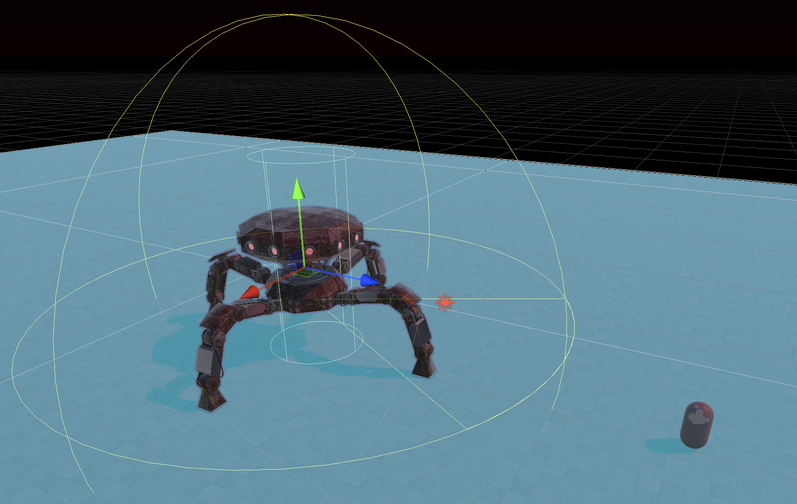
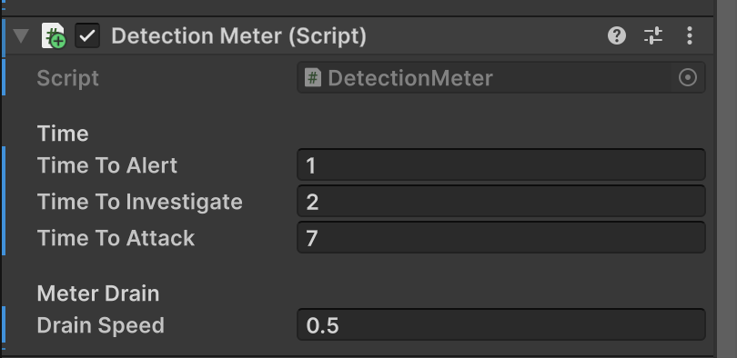

# GETXR Project: Modular Vision Enemy Detection & State Machine
*Aaron Struikenkamp | s3731944 | 04-11-2026*

## Assessment & Setup Information

* **Assessed version:** `<>`
* **Unity version:** `6000.3.23f1`
* **Demo scene:** `Assets/Scenes/TestScene.unity`
* **Controls & setup:** 
  1. Open `TestScene`.
  2. Make sure you bake the NavMesh and place the enemy on the ground (check offset).
  3. In play mode you can check when the player in and out of the enemy's line of sight to see the detection meter fill and the state machine transition between states.
* **Dependencies:** Unity AI Navigation package (for NavMesh). Nothing external.

## Overview
This subsystem provides enemies with the ability to detect the player and react in different states! I made it with a modular architecture where detection logic, state management, NavMesh movement and debug logs are separated into individual components.

## Flowchart
</img>

So then what are the...
## Components of the system

**`VisionSensor`** 
The system uses this to track whether the player is in view for the enemy, and if there are no obstacles in the way.
It has configurable range and FOV.
</img>\
*See the gyzmo and FOV*

* As you can read in the code itself, it uses three steps: 
Distance (Radius) -> Field of View (Math3D principles) -> Line of Sight (Raycast against an Obstacle LayerMask).

**`DetectionMeter`** 
Handles fill and emptying rates and thresholds. 
* The meter runs from 0 to 1 based on time spent in view. It is designed this way so it can easily be linked to probabilities or a UI progress bar in the future.

**`EnemyStateMachine`** 
Tracks the current state and communicates it with the rest of the program.
* **Patrol:** The default state when no detection is happening.
* **Alert:** The player has just been spotted.
* **Investigate:** The enemy moves to the player's `LastSeenPosition` using the NavMesh.
* **Attack:** The player has been in sight for too long and the enemy chases the player.

**`NavMeshMover`** 
Thin wrapper around `NavMeshAgent`. It decouples movement from the state logic. The state machine simply calls `MoveTo(Vector3 position)` or `Stop()`, and the mover handles the pathfinding and repathing intervals.

> *(Note: `EnemyConfig` is is more the changes you pass through per enemy. Think of values like range, FOV, and detection rates, so enemies become configurations of one system. This is all done in the Unity Inspector and not through code editing. Even rotations can just be done with empty gameObjects)*\
> </img>

## Authorship & Sources
* **Original Code:** The scripts (`VisionSensor`, `DetectionMeter`, `EnemyStateMachine`, `State`, `NavMeshMover`, `DebugLogs`) were written by me (Aaron Struikenkamp) for this project.
* **Adapted Code:** The basic `NavMeshAgent` movement and pursuit logic is adapted from a previous GETXR assignment. 
* **AI Assistance:** AI (DeepSeek) was used for debugging (e.g., fixing C# accessibility errors and helping troubleshoot layer/FOV math) and for code review/refactoring suggestions.

**Sources used:**
- [Unity Documentation: Physics.OverlapSphere](https://docs.unity.com/en-us/engine/6000.6/script-reference/unityengine/physics/overlapsphere)
- [YouTube: Unity Vision Cone Tutorial](https://www.youtube.com/watch?v=sUMEnIUeVro)