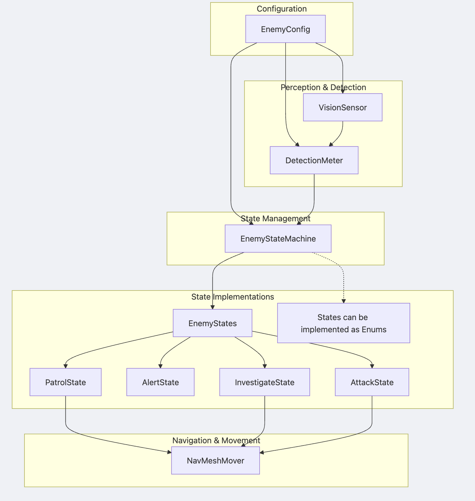

### Components of the system
`VisionSensor` : configurable range and FOV. Outputs whether the player is visible and the last seen
position.

`DetectionMeter` : handles fill and emptying rates and tresholds.

`EnemyStateMachine` : runs the current state and communicates it with the rest of the program.
- Patrol
- Alert
- Investigate
- Attack

`NavMeshMover` : thin wrapper around NavMeshAgent for patrol waypoints and moving to a position.
EnemyConfig

### Flowchart
</img>